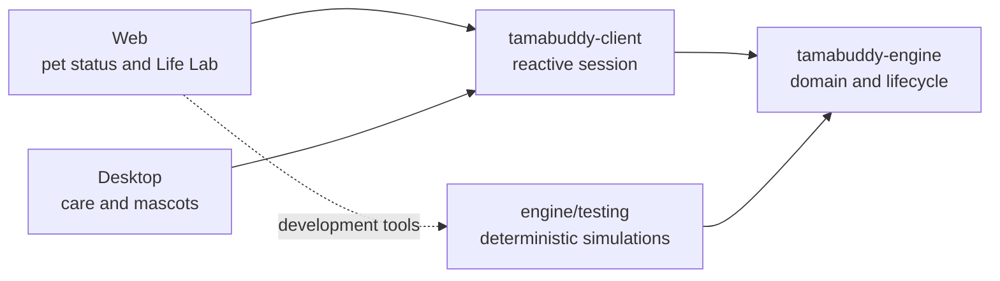

# Tamabuddy

Tamabuddy is a virtual pet whose lifecycle is calculated by a shared TypeScript engine. The monorepo contains web and desktop experiences, a reusable session layer, and deterministic tools for testing and exploring how the pet changes over time.

Pet rules are kept separate from user interfaces. Feeding, hygiene, sleep, illness, evolution, attention calls, and death belong to the engine; applications translate that state into interactions and presentation.

## At a glance



| Project                                                      | Responsibility                                                                         |
| ------------------------------------------------------------ | -------------------------------------------------------------------------------------- |
| [`apps/tamabuddy-web`](apps/tamabuddy-web/README.md)         | Browser experience and a development-only Life Lab for inspecting simulations.         |
| [`apps/tamabuddy-desktop`](apps/tamabuddy-desktop/README.md) | Tauri desktop application with mascot selection, care, games, and settings.            |
| [`libs/tamabuddy-client`](libs/tamabuddy-client/README.md)   | Observable session that serializes operations and connects an interface to the engine. |
| [`libs/tamabuddy-engine`](libs/tamabuddy-engine/README.md)   | Domain rules, lifecycle orchestration, persistence adapters, and simulation toolkit.   |

## Experiences

### Desktop

The main pet-care experience. It lets users select a mascot, monitor its needs, perform care actions, play, manage preferences, and reset the game. Pet state is persisted in `localStorage`; mascot preferences use a separate versioned store.

### Web

A smaller surface for viewing the pet and sending actions. In development it also exposes **Life Lab**, which runs individual and batch simulations, compares owner strategies, inspects events, and renders state series. Life Lab is removed from production bundles and guarded by a dedicated verification target.

## Architecture

A typical operation follows this path:

1. an application sends a command through the shared client;
2. the client serializes the operation and invokes the engine;
3. the engine loads the aggregate, processes elapsed time, applies rules, and persists the new state;
4. the client publishes an updated snapshot to the interface.

Dependencies point inward toward the domain. The engine does not depend on React or UI lifecycle. Time and persistence enter through replaceable ports. Consumers use package entrypoints and never import internal `src/lib` paths.

```text
apps/
├── tamabuddy-desktop/  # React + Tauri
└── tamabuddy-web/      # React + Vite; Life Lab in development
libs/
├── tamabuddy-client/   # session shared by the applications
└── tamabuddy-engine/   # domain, engine, adapters, and simulation
```

Architectural decisions, constraints, and verified implementation state live in the [AI harness](.ai-harness/README.md). Engine and desktop changes also have domain-specific entrypoints there.

## Technology

- Node.js 22 and pnpm;
- Nx for monorepo orchestration;
- TypeScript 6, React 19, and Vite 8;
- Vitest and Testing Library;
- XState 5 inside the engine state machine;
- Tauri 2 and Rust for the desktop application.

## Getting started

### Prerequisites

- Node.js `22.21.1`, as recorded in `.nvmrc`;
- pnpm;
- for native desktop development, Rust `1.90` and the [Tauri system prerequisites](https://v2.tauri.app/start/prerequisites/).

Install dependencies from the repository root:

```bash
pnpm install
```

Start an experience:

```bash
# Web at http://localhost:4200
pnpm nx run @tamabuddy/tamabuddy-web:dev

# Desktop frontend in a browser at http://127.0.0.1:4210
pnpm nx run @tamabuddy/tamabuddy-desktop:dev

# Native desktop application
pnpm nx run @tamabuddy/tamabuddy-desktop:native:dev
```

## Common commands

These commands run against every applicable project. The coverage command currently targets the desktop application, the only project that defines a `test:coverage` target.

```bash
pnpm build
pnpm typecheck
pnpm lint
pnpm test
pnpm test:coverage
pnpm format:check
```

To target one project, run `pnpm nx run <project>:<target>`:

```bash
pnpm nx run @tamabuddy/tamabuddy-engine:test
pnpm nx run @tamabuddy/tamabuddy-web:build
```

Use `pnpm nx show project <project>` to inspect all inferred and explicit targets.

## Contributing

- Keep tests and mocks next to the implementation they support.
- Name tests `*.spec.ts` or `*.spec.tsx`, and mocks `*.mock.ts` or `*.mock.tsx`.
- Preserve dependency direction and package entrypoints.
- Update tests and the owning formal documentation when domain behavior changes.
- Use Conventional Commits in the form `<type>(<scope>): <message>`.

Full contributor and agent guidance starts at [`.ai-harness/README.md`](.ai-harness/README.md). Executable code and tests remain the final evidence of implemented behavior.
