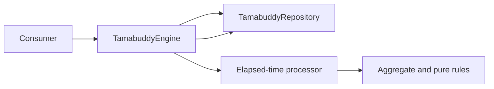

# Tamabuddy Engine

TypeScript engine that owns Tamabuddy state, rules, and lifecycle processing. It is independent from React and can operate with real or deterministic clocks and repositories.

Package: `@tamabuddy/tamabuddy-engine`.

## Implemented capabilities

- a snapshot-backed `Tamabuddy` aggregate with schema, range, and chronology validation;
- stages, needs, actions, decay, sleep, illness, attention, evolution, and death;
- elapsed-time processing at scheduled boundaries instead of minute polling;
- an XState machine for `egg`, `idle`, `sleeping`, and terminal `dead` behavior;
- a `TamabuddyEngine` facade for create, load, process, command, and save workflows;
- clock and repository ports;
- system clock, in-memory repository, and `localStorage` repository adapters;
- deterministic simulations, scenarios, owner strategies, seeded replay, and batch campaigns through a separate testing entrypoint.

Durable persistence, concurrency control, legacy save migration, and real variation through domain strategies, policies, or specifications are approved future concerns—not current components.

## Operation flow



For each operation, the facade loads the aggregate, processes elapsed time through the injected `Clock`, applies a valid command, and saves the resulting snapshot. Rejected commands also return processed state so consumers remain synchronized.

## Layers

```text
src/lib/
├── domain/          # entities, value objects, models, and pure rules
├── application/     # services and ports
├── engine/          # facade, state machine, and processors
├── infrastructure/  # concrete clock and persistence adapters
├── public-api/      # production contract
└── testing/         # deterministic toolkit and its public contract
```

Dependencies point inward:

```text
UI -> public API -> application/engine -> domain
                         ^
                         |
                  infrastructure
```

Domain code does not import infrastructure, browser APIs, timers, or React. Consumers never import `src/lib/**` directly.

## Production API

The `@tamabuddy/tamabuddy-engine` entrypoint exposes:

- `TamabuddyEngine`, `Tamabuddy`, `TamabuddyId`, and `LoadTamabuddy`;
- selected domain state, commands, results, and types;
- the `Clock` and `TamabuddyRepository` contracts;
- `SystemClock`, `InMemoryTamabuddyRepository`, and `LocalStorageTamabuddyRepository`;
- `getHatchDeadline` and `ElapsedTimeProcessor`.

Minimal example:

```ts
import {
  InMemoryTamabuddyRepository,
  SystemClock,
  TamabuddyEngine,
  TamabuddyId,
} from '@tamabuddy/tamabuddy-engine';

const repository = new InMemoryTamabuddyRepository();
const engine = new TamabuddyEngine(new SystemClock(), repository);
const id = TamabuddyId.create('primary-pet');

await engine.create(id);
const result = await engine.command(id, { type: 'feedMeal' });
```

## Simulation API

Development and test tools use the separate `@tamabuddy/tamabuddy-engine/testing` subpath. It exposes life, owner, and batch runners; semantic timelines; a scenario DSL; invariants; presets; owner strategies; duration helpers; and deterministic replay.

```ts
import {
  days,
  LifeSimulationRunner,
  scenario,
} from '@tamabuddy/tamabuddy-engine/testing';
```

The subpath deliberately excludes internal traces, arbitrary-state builders, raw virtual-clock and random-source implementations, and test-framework dependencies.

## Validate

From the monorepo root:

```bash
pnpm nx run @tamabuddy/tamabuddy-engine:typecheck
pnpm nx run @tamabuddy/tamabuddy-engine:lint
pnpm nx run @tamabuddy/tamabuddy-engine:test
pnpm nx run @tamabuddy/tamabuddy-engine:build
pnpm nx run @tamabuddy/tamabuddy-engine:testing-entrypoint-check
```

Long-running invariant campaigns are separate from the regular suite:

```bash
pnpm nx run @tamabuddy/tamabuddy-engine:batch-invariants
```

## Before changing the engine

Read the [domain entrypoint](../../.ai-harness/domains/tamabuddy-engine/README.md), [current implementation state](../../.ai-harness/domains/tamabuddy-engine/docs/current-state.md), and [dependency rules](../../.ai-harness/domains/tamabuddy-engine/rules/dependency-boundaries.md). Behavior changes must update tests and the formal document that owns the rule.

Return to the [monorepo overview](../../README.md).
